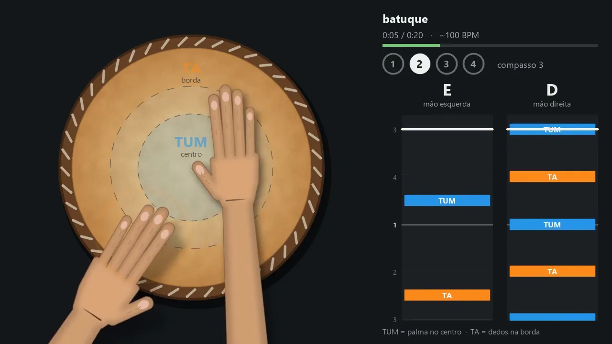
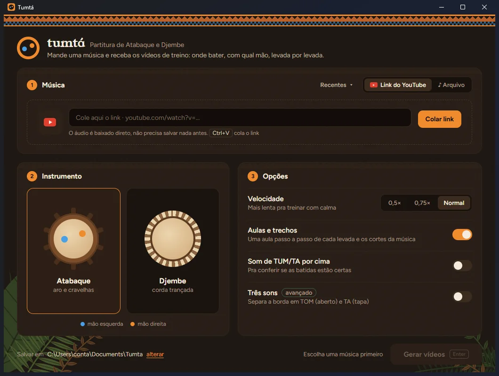
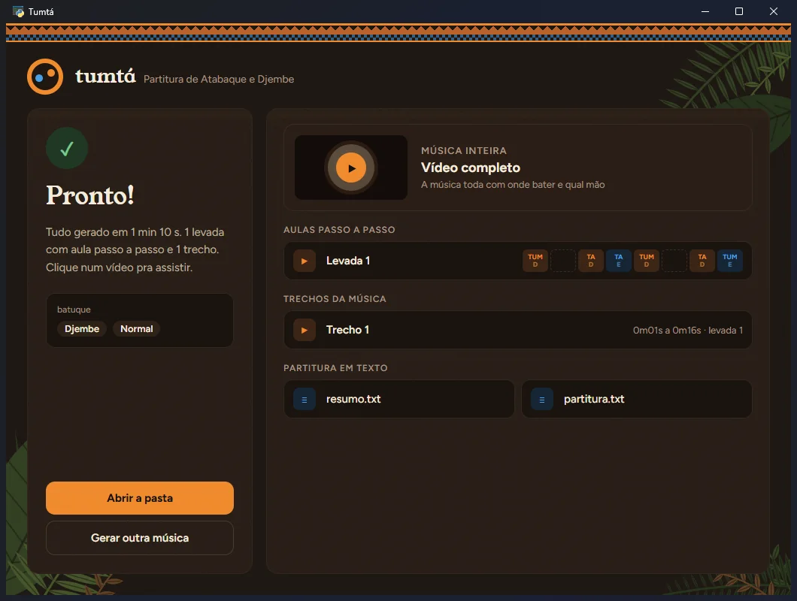

<p align="center">
  
</p>

<h1 align="center">Tumtá</h1>
<p align="center"><b>Partitura de atabaque e djembe em vídeo, a partir de qualquer música.</b></p>

<p align="center">
  <a href="https://github.com/aeusteixeira/tumta/releases/latest/download/Tumta.zip"><b>⬇ Baixar para Windows</b></a> ·
  <a href="https://aeusteixeira.github.io/tumta/">Site</a> ·
  <a href="LEIAME.md">Documentação</a>
</p>

<p align="center">
  
</p>

Mande uma música (arquivo ou link do YouTube) e o Tumtá:

1. separa o som do tambor do resto da música;
2. encontra cada **TUM** (grave, palma no centro) e cada **TA** (borda, dedos perto do aro);
3. gera vídeos mostrando **onde bater e com qual mão**: o vídeo completo, uma **aula passo a passo de cada levada** e os **cortes de cada trecho**.

Funciona com atabaque ou djembe, em velocidade normal, 0,75× ou 0,5×. Tem um modo avançado de três sons, que separa a borda em TOM (aberto) e TA (tapa).

## Baixar e usar

1. Baixe o [`Tumta.zip`](https://github.com/aeusteixeira/tumta/releases/latest/download/Tumta.zip) (Windows 10 ou 11, 64 bits).
2. Extraia e abra `Tumta.exe`.
3. Cole o link do YouTube ou arraste a música, escolha o tambor e clique em **Gerar vídeos**.

Se o Windows mostrar "O Windows protegeu o computador", clique em **Mais informações** e depois em **Executar assim mesmo**. O aviso aparece porque o programa não tem assinatura digital paga.

<p align="center">
  
  
</p>

## Rodar pelo código

```
python -m venv .venv
.venv\Scripts\python.exe -m pip install demucs librosa opencv-python soundfile pillow pywebview "yt-dlp[default]" deno
.venv\Scripts\python.exe app.py
```

Também precisa do [ffmpeg](https://ffmpeg.org/) no PATH. Pela linha de comando:
`python partitura.py musica.mp3 --trechos --instrumento atabaque`. Todas as opções estão no [LEIAME](LEIAME.md).

Para montar o `.exe`, use `python empacotar.py` (detalhes no LEIAME).

## Feito com

[Demucs](https://github.com/facebookresearch/demucs) (separação do tambor) ·
[librosa](https://librosa.org/) (batidas e andamento) ·
[OpenCV](https://opencv.org/) e [ffmpeg](https://ffmpeg.org/) (vídeo) ·
[yt-dlp](https://github.com/yt-dlp/yt-dlp) (YouTube) ·
[pywebview](https://pywebview.flowrl.com/) (janela) ·
fontes [Young Serif](https://fonts.google.com/specimen/Young+Serif) e [Figtree](https://fonts.google.com/specimen/Figtree).
